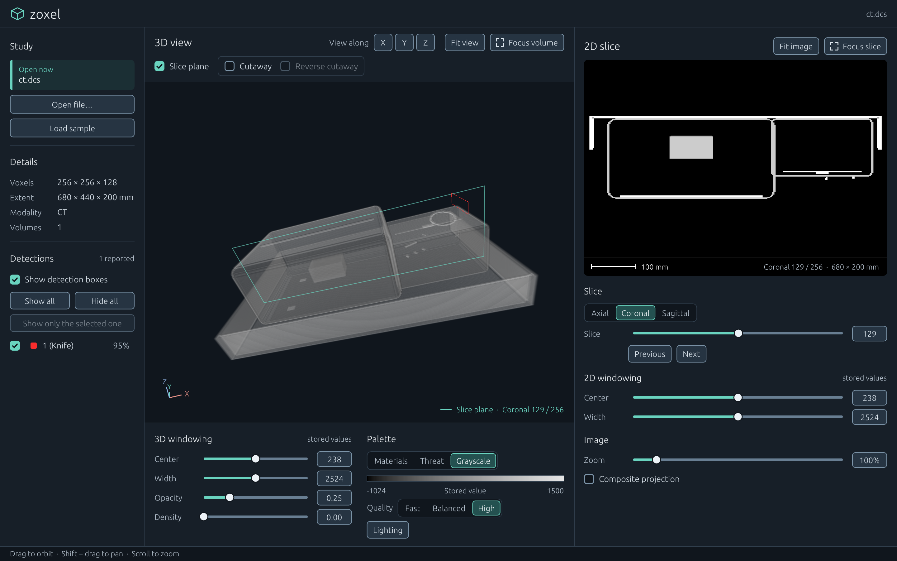
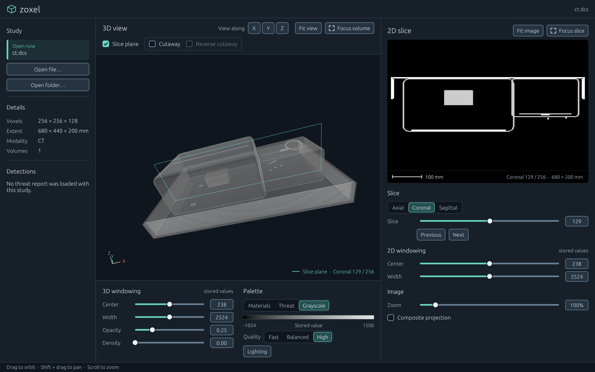

# dicos.zig

> **[▶ Try Zoxel in your browser](https://jpfielding.github.io/dicos.zig/)**: the
> GPU volume viewer compiled to WebAssembly. It opens a sample CT scan with a
> threat report, or you can load your own `.dcs` files. Needs WebGPU (a recent
> desktop Chrome or Edge, or Safari 26+).

[](https://jpfielding.github.io/dicos.zig/)

A pure-Zig library and toolkit for working with **DICOS** (Digital Imaging and
Communication in Security) files. DICOS is the NEMA IIC 1 standard used by
security screening equipment (CT scanners, X-ray systems) to encode volumetric
and projection image data. It is closely related to DICOM but tailored for
aviation and checkpoint security workflows.

This project implements the NEMA IIC 1 v04-2023 specification and provides:

- A core parsing library for reading and writing DICOS datasets and pixel data.
- Four standalone lossless compression codecs (no DICOS dependency).
- A CLI tool (`dicosctl`) for inspecting files from the terminal.
- A GPU-accelerated volume viewer (`zoxel`) with 3D ray-casting and 2D slice
  display, for the desktop and the browser.

Ported from [dicos.rs](https://github.com/jpfielding/dicos.rs) 2.1.0. The
library and codecs are pure Zig with no C dependencies; only the viewer links
C/C++ (Dawn, GLFW, Dear ImGui).

## Project Components

### dicos -- Core Library

The `dicos` module parses DICOS/DICOM binary files into an in-memory `Dataset`
of typed elements. It handles explicit and implicit VR transfer syntaxes,
encapsulated pixel data, and multi-frame volumes. Codec modules are wired in
through the codec registry; each one can be left out with a build option
(`-Ddicos-rle=false`, `-Ddicos-jpegls=false`, `-Ddicos-jpegli=false`,
`-Ddicos-jpeg2k=false`), so downstream consumers only pay for what they use.

### Compression Codecs

Pure Zig implementations of the lossless image compression formats used by
DICOS and DICOM. Each codec is a standalone module with **zero dependency on
`dicos`**, so they can be used independently in any imaging pipeline.

Like the Rust 2.x crates they port, these codecs emit **standards-conformant**
streams within an explicit, documented scope; anything legal-but-unsupported is
rejected loudly rather than encoded incorrectly. For identical input and
options the encoders emit the same bytes as the Rust crates. See the
"Conformance scope" table below and each module's README for the full support
matrix.

| Module | Standard | Algorithm |
|--------|----------|-----------|
| [**jpeg2k**](src/jpeg2k/README.md) | ITU-T T.800 | Wavelet (5/3 DWT + EBCOT + MQ) |
| [**jpegli**](src/jpegli/README.md) | ITU-T T.81 Annex H | DPCM (Process 14 SV1) |
| [**jpegls**](src/jpegls/README.md) | ISO/IEC 14495-1 / ITU-T T.87 | LOCO-I |
| [**jpegrle**](src/jpegrle/README.md) | DICOM Part 5 Section 8.1.1 | PackBits RLE |

#### Conformance scope

| Module | Conformant profile | Verified against |
|--------|--------------------|------------------|
| **jpeg2k** | T.800 lossless codestreams: 1 tile, 1 component (unsigned 16-bit), reversible 5/3 DWT, LRCP, 1 layer, `cb_style=0`, zero grid origins. Everything else legal-but-unsupported is rejected (`error.Unsupported`) via a validated support matrix. 1.0.0 / Go raw-DWT files remain decodable through `LegacyPolicy` (`.auto` by default). | **OpenJPEG** (`opj_compress`/`opj_decompress`), both directions (`tests/interop.zig`, skipped when the tools are absent); a digest table from the Rust crate (`tests/parity.zig`) |
| **jpegls** | T.87 single-component and planar multi-component (`ILV=0`, e.g. RGB, via `encodeImage`/`decodeImage`), precision 2..=16, LSE ID=1 presets honored, run mode, near-lossless. Interleaved scans (`ILV≠0`) and restart markers inside a scan are rejected as `error.Unsupported`; a bare `DRI` segment is skipped. `Profile.legacy_go` reproduces the frozen 1.0.0 / Go-compatible bytes. | Round-trip and Rust parity; third-party `.jls` fixtures when present and, opt-in (`DICOS_CHARLS_INTEROP=1`), **CharLS** decoding (see `src/jpegls/testdata/interop/README.md`) |
| **jpegli** | T.81 Process 14 lossless: default selection value 1 (SV1), predictors 1–7 selectable, point transform, restart intervals (row-aligned per H.1.1), precision 2..=16. | **libjpeg-turbo ≥ 3.0** (`cjpeg -lossless` / `djpeg`), both directions: embedded fixtures always, live tools when installed |
| **jpegrle** | DICOM Part 5 §8.1.1 PackBits RLE; 16-bit split into high/low byte segments. | Round-trip, DICOM fixtures, and byte-identical output to the Rust crate |

### dicosctl -- CLI Inspector

A command-line tool for quick inspection of DICOS files (`src/dicosctl`),
installed by `zig build` as `zig-out/bin/dicosctl`.

### zoxel -- GPU Volume Viewer

A three-panel application for visualizing 3D CT volumes and 2D slices from
DICOS files: a port of the Rust viewer roxel that looks and behaves the same.
Uses the zig-gamedev ecosystem: zgpu (WebGPU through Dawn) for GPU ray-casting
and zgui (Dear ImGui) for the interface.



```text
+------------+------------------------+------------------------+
| Sidebar    |   3D Volume View       |   2D Slice View        |
|            |   (GPU ray-caster)     |   (CPU rendered)       |
| Study      |                        |                        |
| Details    +------------------------+------------------------+
| Detections | 3D windowing | Palette | Slice: plane, index    |
|            | Opacity      | Quality | 2D windowing           |
|            | Density      | Lighting| Zoom, Composite [x]    |
+------------+------------------------+------------------------+
```

- **Left sidebar** -- open actions, the open study, volume details and the
  threat detections, each with a visibility toggle.
- **Center panel** -- GPU ray-cast 3D volume rendering with an orbit camera
  (left-drag to rotate, scroll to zoom, view along X/Y/Z), slice plane and
  cutaway; windowing, palette (Grayscale / Materials / Threat), quality and
  lighting below it.
- **Right panel** -- CPU-rendered 2D slice viewer with plane selector, slice
  index, window/level controls, zoom and composite projection.

The desktop build needs a GPU with Vulkan, Metal, or D3D12 support. A browser
build (WebGPU) runs at <https://jpfielding.github.io/dicos.zig/>; see
[src/zoxel/README.md](src/zoxel/README.md#web-demo).

## Project Structure

```
dicos.zig/
  build.zig             # Build system (native and wasm32-emscripten)
  build.zig.zon         # Package manifest
  testdata/             # Curated DICOS samples (Git LFS); synthetic/ is generated
  deps/
    zgpu/               # Vendored zig-gamedev zgpu, patched for Emscripten
    zgui/               # Vendored zig-gamedev zgui
  web/                  # Browser page (shell.html) and headless test tools
  src/
    dicos/              # Core DICOS library (+ gen-luggage-fishtank example)
    jpegrle/            # RLE PackBits codec (standalone)
    jpegls/             # JPEG-LS codec (standalone)
    jpegli/             # JPEG Lossless codec (standalone)
    jpeg2k/             # JPEG 2000 codec (standalone)
    dicosctl/           # CLI inspector
    zoxel/              # GPU-accelerated volume viewer
```

## Dependency Graph

```
jpegrle ----+
jpegls  ----|  (standalone, zero dicos dependency)
jpegli  ----|
jpeg2k  ----+
                dicos --> uses codec modules via codec_registry
                  |       (each can be disabled with -Ddicos-<codec>=false)
                  |
           dicosctl --> dicos
           zoxel    --> dicos + zig-gamedev (zglfw, zgpu, zgui)
```

## Building

Requires Zig **0.15.2**.

```sh
# Build everything (dicosctl and zoxel into zig-out/bin/)
zig build

# Run all library, codec and tool tests
zig build test

# Run the viewer's tests (no window or GPU needed)
zig build zoxel-test

# Build zoxel for the browser (needs emsdk 4.0.3; see src/zoxel/README.md)
zig build -Dtarget=wasm32-emscripten -Doptimize=ReleaseFast

# Release build of the viewer (recommended for interactive use)
zig build -Doptimize=ReleaseFast
```

A [devcontainer](.devcontainer/) provides Zig 0.15.2 and emsdk 4.0.3.

## Test data

`testdata/` holds curated, public-safe DICOS samples that the reader and
luggage integration tests depend on (notably `testdata/bag_ct.dcs`, and two
synthetic luggage studies, each with a CT and its threat report). The `.dcs`
files are stored with **Git LFS**: install it and run `git lfs pull` after
cloning, or you will have small pointer files instead of scans. Only
`testdata/synthetic/`, the fixture the example generator produces, is
gitignored. Tests that read `testdata/` files skip when a fixture is absent,
so a partial checkout stays green.

To produce a synthetic public-safe CT volume via the example generator:

```sh
mkdir -p testdata/synthetic
zig build gen-luggage-fishtank -- \
  --size 64,64,48 --out testdata/synthetic/luggage_fishtank_ct.dcs
```

`--size x,y,z` accepts any axis ≥ 32; omit `--out` to write the default path.
`--seed`, `--with-noise on|off` and `--include-threat-tags on|off` are also
accepted. For the same arguments it writes a file byte-identical to the Rust
example's. CI runs this step before the test suite.

## Usage

### dicosctl

```sh
# Print a human-readable summary of a DICOS file
./zig-out/bin/dicosctl info testdata/bag_ct.dcs

# Example output:
#   File: testdata/bag_ct.dcs
#   Elements: 69
#   Modality: CT
#   Dimensions: 256x256
#   Frames: 128
#   Bits Allocated: 16
#   Transfer Syntax: Explicit VR Little Endian (1.2.840.10008.1.2.1)
#   SOP Class: 1.2.840.10008.5.1.4.1.1.2
#   ...

# Dump all metadata as JSON (pretty-printed by default)
./zig-out/bin/dicosctl dump scan.dcs

# Pipe JSON output to jq for querying
./zig-out/bin/dicosctl dump scan.dcs | jq '.Modality'

# Compact (single-line) JSON
./zig-out/bin/dicosctl dump --compact scan.dcs
```

### zoxel

```sh
# Launch with an empty viewport, then use Open file or Open folder
./zig-out/bin/zoxel

# Load a single DICOS file directly (threat reports named *threat* next to it are merged)
./zig-out/bin/zoxel scan.dcs

# Load .dcs/.dcm files from a directory as separate volume layers
./zig-out/bin/zoxel /path/to/study/
```

The dark inspection workspace provides automatic framing, linked slice-plane
location, focused 3D inspection, an expanded slice inspector, and optional
cutaway clipping. Advanced lighting and material controls open on demand.

**Mouse controls:**

| Action | Effect |
|--------|--------|
| Left-drag in 3D view | Rotate volume (orbit) |
| Scroll wheel | Zoom in/out |
| Shift + left-drag | Pan the 3D volume |
| Escape | Return from focused or expanded inspection |

**Transfer function presets:**

| Preset | Description |
|--------|-------------|
| Materials | Five-band material: Air (transparent), Organic (orange), Inorganic (green), Metal (blue), Dense (dark blue) |
| Threat | Red monochrome for threat highlighting |
| Grayscale (startup) | Monotonic grayscale with lifted midtones |

See [src/zoxel/README.md](src/zoxel/README.md) for full documentation,
including the web demo, reproducible screenshots, architecture and GPU
requirements.

## References

- [NEMA IIC 1 -- DICOS Standard](https://www.nema.org/standards/view/Digital-Imaging-and-Communications-in-Security)
- [DICOM Standard](https://www.dicomstandard.org/)
- [suyashkumar/dicom (Go reference)](https://github.com/suyashkumar/dicom)
- [Stratovan DICOS/DICOM format](https://www.stratovan.com/products/dicos)
- [JPEG-LS (ISO/IEC 14495-1)](https://en.wikipedia.org/wiki/Lossless_JPEG#JPEG-LS)
- [JPEG 2000 (ITU-T T.800)](https://en.wikipedia.org/wiki/JPEG_2000)
- [JPEG Lossless (ITU-T T.81 Annex H)](https://en.wikipedia.org/wiki/Lossless_JPEG)
- [DICOM RLE (Part 5 Section 8.1.1)](https://dicom.nema.org/medical/dicom/current/output/chtml/part05/sect_8.2.html)

## Acknowledgements

Built with [Claude Code](https://claude.ai/claude-code) by Anthropic.
