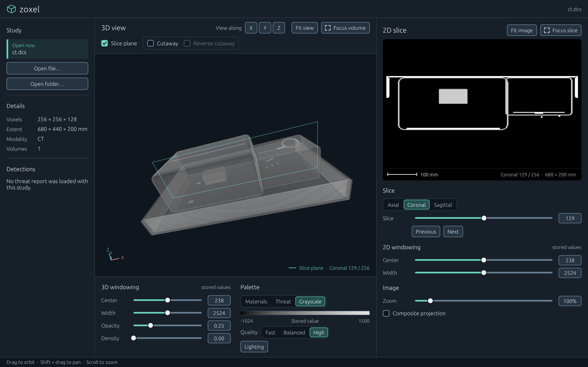
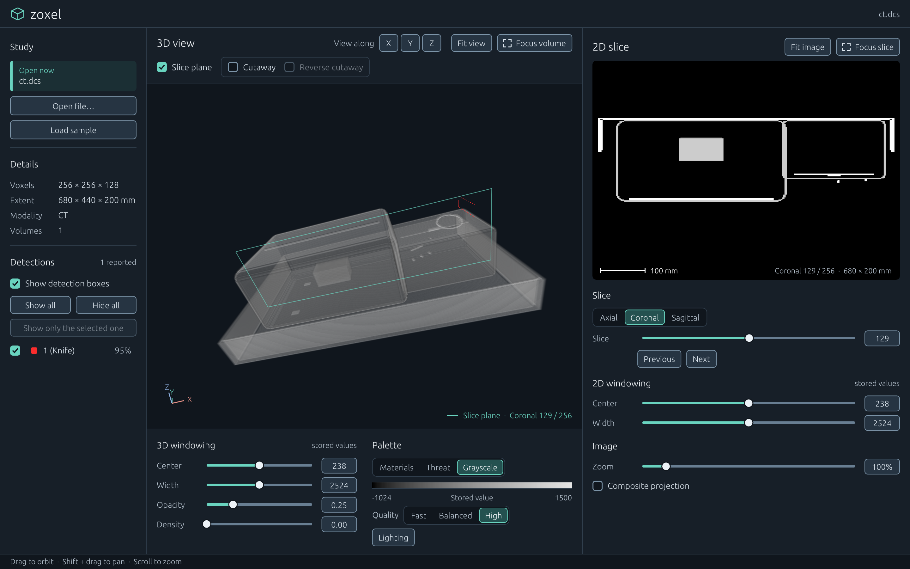

# Zoxel

A GPU-accelerated DICOS volume inspection workspace, built with WebGPU (Dawn,
through zig-gamedev `zgpu`) and Dear ImGui (`zgui`). It is a port of the Rust
viewer [roxel](https://github.com/jpfielding/dicos.rs/tree/main/crates/roxel)
and looks and behaves the same.



## Run

```sh
zig build
./zig-out/bin/zoxel
./zig-out/bin/zoxel scan.dcs
./zig-out/bin/zoxel /path/to/study/
```

Use **Open file** for a `.dcs` or `.dcm` file, or **Open folder** for volume
layers from a directory. The file pickers are the platform's own dialogs
(`osascript` on macOS, `zenity` on Linux). Loading and gradient preparation run
on a worker thread. The existing study remains visible while a replacement
loads; errors appear in the study panel. Directory loading keeps readable image
files as separate named layers; it does not automatically stack those layers.
Failed files are logged.

Threat reports are found next to the opened file (or in the opened folder) when
their file name contains `threat` (case-insensitive), as roxel does. Detections
are listed in the study panel and outlined in both views.

## Web demo

A browser build (wasm32-emscripten + WebGPU) runs at
<https://jpfielding.github.io/dicos.zig/>. It is the same interface, built from
the same code. On first launch it opens a bundled synthetic sample: a backpack
with a fishtank and a knife threat report. Use **Open file…** to choose your
own `.dcs` files. Select the CT and its threat report together to see the
threat boxes. **Load sample** reloads the bundled scan.



**Browser support:** WebGPU, which means a recent desktop Chrome or Edge,
Safari 26+, or Firefox 141+ on Windows. The renderer needs no optional WebGPU
features. Browsers without WebGPU see an explanation instead of a blank page.

**Run it locally.** You need [emsdk](https://emscripten.org/docs/getting_started/downloads.html)
**4.0.3** (the devcontainer already has it, in `$EMSDK`):

```sh
git clone --branch 4.0.3 https://github.com/emscripten-core/emsdk.git ~/.local/share/emsdk
~/.local/share/emsdk/emsdk install 4.0.3 && ~/.local/share/emsdk/emsdk activate 4.0.3
~/.local/share/emsdk/upstream/emscripten/embuilder build sysroot

# Finds emsdk through -Demsdk=<dir>, then $EMSDK, then ~/.local/share/emsdk.
zig build -Dtarget=wasm32-emscripten -Doptimize=ReleaseFast
mkdir -p zig-out/web/samples/fishtank-knife
cp testdata/backpack+purse_fishtank+goldfish_THREAT-knife_20260227-191512/{ct,tdr}.dcs \
   zig-out/web/samples/fishtank-knife/
python3 -m http.server -d zig-out/web 8080    # http://127.0.0.1:8080
```

On macOS, if `emsdk install` fails on the system Python, point it at a newer
one: `EMSDK_PYTHON=$(uv python find 3.12)`.

The output is `zig-out/web/{index.html,index.js,index.wasm}` and uses relative
URLs only, so it works under a sub-path such as `/dicos.zig/`. The page comes
from `web/shell.html`, and the entry point is `web.zig`. `main.zig` supplies
the input, ImGui setup and frame code, which are shared with the desktop build.

To check the page headlessly, `web/tools/cdp-screenshot.mjs` drives Chrome over
the DevTools protocol. It can set the viewport and pixel ratio, drag to orbit,
click GUI buttons, answer the file chooser and hide WebGPU:

```sh
node web/tools/cdp-screenshot.mjs http://127.0.0.1:8080/ web.png --size=1440x900 --dpr=2
node web/tools/cdp-screenshot.mjs http://127.0.0.1:8080/ picked.png \
  --click=115,167 --pick=ct.dcs,tdr.dcs        # "Open file…" in the sidebar
```

**Limits compared with the desktop build:**

- There is no Open folder and no drag and drop. Of the files picked together,
  the largest is the CT. Every other `.dcs`/`.dcm` file is searched for threat
  reports, whatever its name; the desktop build looks for `threat` in the name.
- Files are parsed on the main thread after one frame showing "Loading…", so
  the page pauses while a scan loads. A CT takes about 140–200 MB of wasm heap.
  The heap grows on demand up to 2 GB.
- Touch uses Emscripten's GLFW, which turns the first finger into the mouse.
  One-finger orbit works; pinch and two-finger gestures do not.
- The page draws on every animation frame, even when idle. The desktop build
  waits for input.
- The `ZOXEL_SCREENSHOT` capture options are desktop only. Use the CDP harness
  above instead.
- The toolchain is frozen at **emsdk 4.0.3**. It is the last release with the
  legacy `-sUSE_WEBGPU` bindings (the old `webgpu.h`) that zgpu and
  `imgui_impl_wgpu` are written against. Later releases replace them with the
  `emdawnwebgpu` port. Moving to it means porting zgpu's bindings and the ImGui
  backend. The local zgpu patches (enum values, and using the device that the
  page creates so ASYNCIFY is not needed) are described in
  [`deps/zgpu/PATCHES.md`](../../deps/zgpu/PATCHES.md).

## Inspect a study

The study panel sits on the left, the 3D view in the center, and the slice
inspector on the right. Rendering controls sit below the 3D view. Long study names
are shortened in the middle in the app bar and shown in full in the study panel.
The native minimum window size is 1100 × 720 logical pixels.

Narrow or short viewports switch to a touch layout: a bottom tab bar with
**Study**, **Detections**, **2D slice** and **3D view**. The selected view fills
the main area and its controls sit in a paged sheet, below it in portrait and
beside it in landscape. Tap the selected view's tab to hide or show the sheet.
Every drag gesture has a button alternative (orbit/pan arrows, zoom −/+, slice
−/+). The layout follows the available logical size, not the platform.

New studies open with an oblique, automatically fitted 3D view and a mid-coronal
2D slice. Grayscale, High sampling quality, and 25% global opacity are the
inspection defaults. Grayscale lifts midtones using `0.9 * normalized^0.65`;
its alpha remains linear. Lighting includes an adjustable depth cue that dims
more distant samples. These are display transforms, not changes to voxel data.
Auto windowing, slices and 3D use the same rescale (slope and intercept) domain.

| Action | Result |
|---|---|
| Left-drag in the 3D viewport | Orbit |
| Shift + left-drag | Pan |
| Scroll in the 3D viewport | Zoom |
| View along X / Y / Z | Snap and fit the camera along a volume axis |
| Fit view | Recenter and frame the complete volume |
| Focus volume | Enlarge the volume in place; keep slice, cutaway, windowing, palette and lighting available |
| Escape / Exit focus | Return to the workspace |
| Slice plane | Outline the selected voxel-center plane |
| Cutaway | Hide voxels before the selected plane to expose the remaining interior |

The axis triad shows **volume X/Y/Z**, not patient anatomical directions. The
slice locator and cutaway apply only when 2D and 3D display the same volume and
the 2D view is a single slice. Cutaway retains the half-volume at or after the
selected slice along the selected array axis. **Reverse cutaway** retains the
opposite half. It does not edit or export data. Annotation boxes describe their
original positions and are not cut away.

## Slice inspection

Choose a volume and plane, then navigate using the one-based slice number.
**Composite projection** uses the current transfer function for front-to-back
alpha compositing; the initial view is a single grayscale slice. Window center
and width controls affect the 2D view independently of the 3D controls. Slider
tracks use the study's initial window for useful adjustment resolution; numeric
entry permits a wider range. Values are not labelled as calibrated HU.

**Focus slice** enlarges the slice in place, the same way **Focus volume**
enlarges the 3D view. It keeps the plane selector, previous/next buttons, an
editable slice number, windowing and zoom. Drag the enlarged image to pan when
zoomed; Ctrl + scroll zooms; **Fit image** restores 100% fit. **Exit focus** or
Escape returns to the workspace. In phone portrait, a wide slice is drawn turned
90° to use the screen, and is captioned as turned.
Nearest-neighbor image sampling preserves the visible source pixels. Both views
preserve physical aspect ratios from voxel spacing; slice captions report the
physical field of view. Slice views include a physical scale bar that follows zoom.

## Appearance

| Palette | Display |
|---|---|
| Grayscale | Lifted grayscale midtones with linear alpha; startup default |
| Materials | Five named density bands, editable thresholds and opacity |
| Threat | Red density highlight; does not itself identify threats |

**Lighting** reveals ambient, diffuse, specular, depth cue and density
cutoff. Material bands are hidden until requested. Quality selects Fast,
Balanced or High ray-march sampling. Opacity is corrected for the physical
distance represented by each ray sample, so changing sampling quality does not
intentionally change optical thickness. Extremely long rays use a coarser step to
preserve full-volume coverage within the step budget. High costs more GPU work;
choose Balanced or Fast on slower hardware.

Detected annotations are listed separately from display palettes. Absence of
annotations means none were supplied, not that the study is clear of threats.

## Reproducible screenshots

The application can read back its own rendered GPU frame, including the
interface and the actual loaded volume. It waits for loading to finish and
several frames to settle, writes a PNG, and exits. This requires a desktop
session and a compatible GPU, just like ordinary use.

```sh
STUDY=testdata/backpack+purse_fishtank+goldfish_THREAT-knife_20260227-191512/ct.dcs
ZOXEL_SCREENSHOT=docs/images/zoxel-workspace.png ./zig-out/bin/zoxel $STUDY
ZOXEL_SCREENSHOT=docs/images/zoxel-empty.png ./zig-out/bin/zoxel
ZOXEL_SCREENSHOT=docs/images/zoxel-focus.png ZOXEL_SCREENSHOT_FOCUS=1 ./zig-out/bin/zoxel $STUDY
ZOXEL_SCREENSHOT=docs/images/zoxel-slice.png ZOXEL_SCREENSHOT_EXPANDED=1 ./zig-out/bin/zoxel $STUDY
ZOXEL_SCREENSHOT=docs/images/zoxel-compact.png ZOXEL_SCREENSHOT_SIZE=1100x720 ./zig-out/bin/zoxel $STUDY
ZOXEL_SCREENSHOT=docs/images/zoxel-cutaway.png ZOXEL_SCREENSHOT_SIZE=1100x720 \
  ZOXEL_SCREENSHOT_FOCUS=1 ZOXEL_SCREENSHOT_CUTAWAY=1 ./zig-out/bin/zoxel $STUDY
```

(The `testdata` studies are Git LFS objects; run `git lfs pull` first.)

Capture options only apply when `ZOXEL_SCREENSHOT` is set:

- `ZOXEL_SCREENSHOT_SIZE=WIDTHxHEIGHT`: logical window size; output PNG
  dimensions also depend on the display scale. Sizes under 640 wide or 520 tall
  capture the phone layouts.
- `ZOXEL_SCREENSHOT_EXPANDED=1`: open focused slice inspection.
- `ZOXEL_SCREENSHOT_FOCUS=1`: open focused volume inspection.
- `ZOXEL_SCREENSHOT_CUTAWAY=1`: enable cutaway at the selected slice.
- `ZOXEL_SCREENSHOT_CLICK=x,y;x,y`: tap these logical points, one after another,
  before capturing (for popovers such as Lighting).

Omit the input path to capture the empty state. A failed input produces the
actual error state, so check the screenshot and logs before using it as evidence.

## Tests

```sh
zig build zoxel-test
```

Covers the volume model (windowing, centre of mass, GPU packing of signed data),
DICOS extraction and threat parsing, slice ordering, the loader, camera fitting,
transfer functions, slice rendering, touch gestures, texel decode for both volume
formats, the PNG writer, and headless layout tests: at 1440 × 900, 1100 × 720 and
the phone sizes nothing is clipped in any mode, tabs and sheets behave, and real
pointer/keyboard input drives Next/Previous, Focus and Escape.

## Implementation and GPU support

`app.zig` bridges decomposed UI state (`state.zig`), asynchronous loading
(`loader.zig`) and the renderer. `ui/` contains the theme and panels, written
against `ui/kit.zig`: a small layout and interaction kit with egui's rules
(remembered panel sizes, item spacing, centred rows, right-to-left groups,
columns) drawn through ImGui draw lists, so the panels port line by line from
roxel and land on the same pixels. ImGui runs in physical pixels so its
anti-aliasing fringe matches egui's one-pixel feathering; the interface uses
egui's default font, Ubuntu-Light (`assets/`, Ubuntu Font Licence).
`camera.zig` implements orbit/pan/fit; `slice_view.zig` renders 2D pixels and
defines locator/clipping geometry. `dicos_adapter.zig` is the only file that
uses the `dicos` library: it extracts volumes and threat ROIs and validates
dimensions against the pixel data before allocating. `renderer.zig` uploads the
density and gradient texture and runs `raycast.wgsl`; the 3D viewport uses the
actual unobscured workspace rectangle.

Native-only facilities (files, directories, file dialogs, the loader thread,
screenshots) sit behind `platform.zig`; loading works from in-memory bytes, with
paths as thin wrappers, and runs on the main thread where threads are missing
(the browser, see [Web demo](#web-demo)).

Differences from roxel, all invisible at normal viewing:

- The volume texture is `Rgba16Float` (the WebGPU path in roxel): this Dawn
  binding exposes no 16-bit normalized format. The density decode handles both.
- The transfer table is `Rgba16Float` rather than `Rgba32Float`, because this
  Dawn build cannot request the `float32-filterable` feature.
- ImGui samples every texture linearly, so the slice is uploaded upsampled by an
  integer factor matched to its display size; voxel edges stay hard.
- ImGui does not apply font kerning (Ubuntu-Light has none in `kern`) and its
  glyph rasterizer differs slightly from egui's.
